# Лабораторная работа №5. Облачные базы данных. Amazon RDS

- **ФИО:** Анисимов Виктор
- **Группа:** IA2403
- **Специальность:** Informatică aplicată
- **Уровень:** Advanced
- **Репозиторий:** https://github.com/RisovoePole-cloud/timecapsule

# Часть 1. Базовый уровень

## Задание 1. Размещение и доступ

Создал группу подсетей `lab5-db-subnets` из `private-a` и `private-b`, группу безопасности для веб-сервера и группу `lab5-rds-sg`, которая пускает TCP 5432 только от группы веб-сервера.

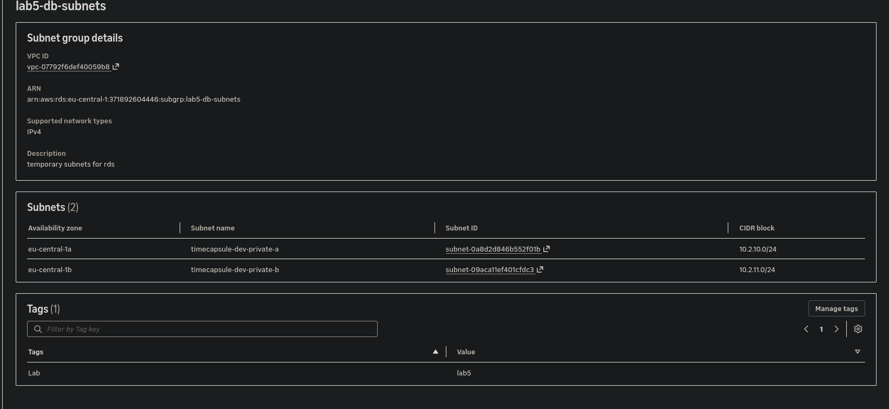

Группа подсетей `lab5-db-subnets` с двумя приватными подсетями из разных зон.

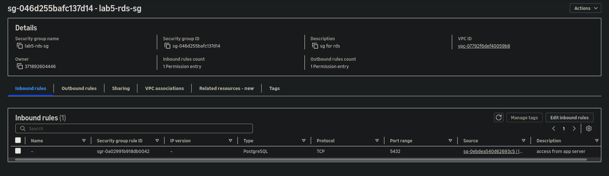

Входящее правило группы RDS: PostgreSQL (5432), источник это группа безопасности веб-сервера.

**Q:** Почему для ограничения доступа удобнее использовать Security Group источника, а не его IP-адрес? Зачем указывать две подсети, если учебная база будет работать в одной зоне?

**A:** Группа-источник не привязана к адресам: при замене или перезапуске сервера, а также при добавлении второго сервера в ту же группу правило продолжает работать, а IP-адрес пришлось бы править вручную. Кроме того, пускаются только члены группы, а не любой хост с нужным адресом. Две подсети нужны, потому что группа подсетей RDS должна охватывать минимум две зоны доступности, даже если экземпляр работает в одной: это позволяет разместить, например, реплику в другой зоне (в Части 1 она стоит в `eu-central-1b`).

## Задание 2. База `lab5-db`

Создал `lab5-db`: PostgreSQL, шаблон Sandbox, `db.t4g.micro`, gp3 20 GiB, пользователь `dbadmin`, подсети `lab5-db-subnets`, зона `eu-central-1a`, публичный доступ выключен, группа `lab5-rds-sg`, база `lab5`, бэкапы 7 дней, шифрование и защита от удаления включены.

**Q:** Как убедиться, что база принимает подключения только с нужного сервера? Почему для неё выбрана зона eu-central-1a? От чего защищает deletion protection, а от чего нет?

**A:** Нужно подключиться с разрешённого сервера (работает) и с любого другого хоста вне группы веб-сервера, например с bastion или моего компьютера (соединение зависает до таймаута). Также в параметрах базы должно быть `Public access: No`, а в `lab5-rds-sg` единственное правило 5432 с источником-группой. Зона `1a` выбрана, потому что шаблон Sandbox создаёт базу без резервного экземпляра, то есть в одной зоне, а сервер приложения тоже в `1a`, так что нет трафика между зонами. Deletion protection защищает от случайного удаления самого экземпляра в консоли или через API, но не защищает от `DELETE` и `DROP TABLE`, от неверных записей и от отказа зоны.

## Задание 3. Подключение и тестовая таблица

```bash
lab5=> SELECT version();
                                                   version
-------------------------------------------------------------------------------------------------
 PostgreSQL 18.3 on aarch64-unknown-linux-gnu, compiled by aarch64-unknown-linux-gnu-gcc (GCC) 12.4.0, 64-bit
(1 row)

lab5=> \conninfo
You are connected to database "lab5" as user "dbadmin" on host "lab5.ctgwu4emslxr.eu-central-1.rds.amazonaws.com" (address "10.2.10.49") at port "5432".
SSL connection (protocol: TLSv1.3, cipher: TLS_AES_256_GCM_SHA384, compression: off)
```

Соединение зашифровано (TLS 1.3), адрес базы приватный (`10.2.10.49` из `private-a`).

```bash
lab5=> SELECT * FROM notes;
 id |  body  |          created_at
----+--------+-------------------------------
  1 | first  | 2026-11-19 13:31:19.028823+00
  2 | second | 2026-11-19 13:31:19.028823+00
  3 | third  | 2026-11-19 13:31:19.028823+00
(3 rows)
```

Адрес endpoint с `app-server`:

```bash
[ec2-user@ip-10-2-0-37 ~]$ dig +short lab5.ctgwu4emslxr.eu-central-1.rds.amazonaws.com
10.2.10.49
```

С моего компьютера:

```fish
$ dig +short lab5.ctgwu4emslxr.eu-central-1.rds.amazonaws.com
10.2.10.49
```

Имя endpoint с обеих сторон разрешается в один и тот же приватный адрес, но с моего компьютера подключиться по нему нельзя: адрес `10.2.10.49` принадлежит приватной подсети, а группа безопасности пускает только веб-сервер.

## Задание 4. Реплика для чтения

Создал `lab5-db-replica` в `eu-central-1b` без публичного доступа.

```bash
[ec2-user@ip-10-2-0-37 ~]$ psql -h lab5-db-replica.ctgwu4emslxr.eu-central-1.rds.amazonaws.com -U dbadmin -d lab5
lab5=> SELECT pg_is_in_recovery();
 pg_is_in_recovery
-------------------
 t
(1 row)

lab5=> SELECT * FROM notes;
 id |  body  |          created_at
----+--------+-------------------------------
  1 | first  | 2026-11-19 13:31:19.028823+00
  2 | second | 2026-11-19 13:31:19.028823+00
  3 | third  | 2026-11-19 13:31:19.028823+00
(3 rows)

lab5=> INSERT INTO notes (body) VALUES ('from replica');
ERROR:  cannot execute INSERT in a read-only transaction
```

На основной базе:

```bash
lab5=> SELECT pg_is_in_recovery();
 pg_is_in_recovery
-------------------
 f
(1 row)

lab5=> insert into notes(body) values('fourth');
INSERT 0 1
```

Затем строка `fourth` на реплике:

```bash
lab5=> select * from notes;
 id |  body  |          created_at
----+--------+-------------------------------
  1 | first  | 2026-11-19 13:31:19.028823+00
  2 | second | 2026-11-19 13:31:19.028823+00
  3 | third  | 2026-11-19 13:31:19.028823+00
  4 | fourth | 2026-11-19 13:50:07.174885+00
(4 rows)
```

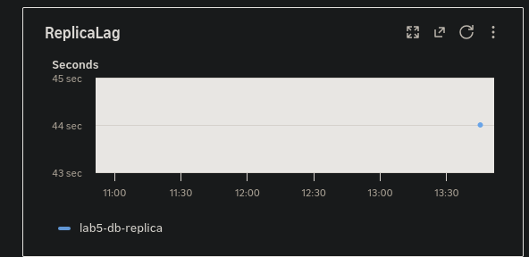

Метрика `ReplicaLag` реплики на вкладке Monitoring.

**Q:** Почему INSERT на реплике не выполнился? Чем реплика для чтения отличается от резервного экземпляра Multi-AZ?

**A:** Реплика работает в режиме восстановления (`pg_is_in_recovery() = t`) и только применяет изменения основной базы, поэтому любая запись на ней запрещена (`read-only transaction`). Реплика для чтения асинхронно копирует данные, имеет собственный endpoint и обслуживает запросы на чтение, разгружая основную базу. Резервный экземпляр Multi-AZ синхронно копирует основную базу только для отказоустойчивости, читать из него нельзя, а при сбое адрес базы переключается на него.

## Задание 5. Восстановление на момент времени

**Q:** Почему реплика не спасла данные? Почему восстановление создаёт новую базу, а не откатывает старую?

**A:** Реплика применяет все изменения основной базы, в том числе `DELETE`, поэтому строки пропали и на ней: репликация это не резервная копия. Восстановление на момент времени собирает отдельный экземпляр из снимка и журнала изменений на выбранный момент, а исходная база остаётся нетронутой: можно сравнить данные и перенести только нужное, не рискуя потерять более поздние записи.

После заданий Часть 1 удалил (`lab5-db`, группа подсетей и `lab5-rds-sg`).

# Часть 2. Продвинутый уровень

## Задание 6. База приложения

Создал группу подсетей `timecapsule-dev-db-subnets` из двух приватных подсетей в разных зонах и экземпляр `timecapsule-dev-rds` (PostgreSQL, `db.t4g.micro`, группа `timecapsule-dev-rds-sg`, начальную базу не создавал).

## Задание 7. Расписание остановки

Создал политику `timecapsule-dev-rds-stop` (только `rds:StopDBInstance` на `timecapsule-dev-rds`), роль `timecapsule-dev-scheduler-role` (принимать её может только EventBridge Scheduler) и расписание `timecapsule-dev-rds-nightly-stop` (cron `0 23 * * ? *`, часовой пояс `Europe/Chisinau`, окно `Off`, цель `StopDBInstance`).

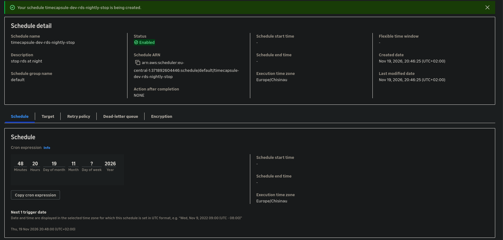

Настройки расписания `timecapsule-dev-rds-nightly-stop`.

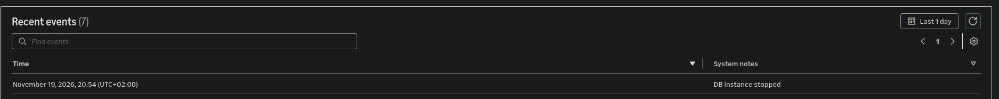

Событие остановки базы по расписанию.

**Q:** Зачем расписанию своя роль, если вы и сами можете остановить базу? Почему роль может остановить только одну базу?

**A:** Расписание выполняется без меня, поэтому действует от имени роли, а не от моего пользователя, и этой роли явно нужно выдать право на нужное действие; принимать её может только сервис `scheduler.amazonaws.com`. Политика разрешает `StopDBInstance` только на ARN `timecapsule-dev-rds`: по принципу наименьших привилегий при компрометации роли нельзя остановить другие базы, а нужное действие остаётся единственным.

## Задание 8. Пользователь и база приложения

Подключился как `dbadmin` к базе `postgres` и создал пользователя `timecapsule`, выдал `dbadmin` членство в его роли и создал базу `timecapsule` с владельцем `timecapsule`.

**Q:** Почему приложению нужен отдельный пользователь, а не dbadmin?

**A:** `dbadmin` может всё: менять любые базы и роли. Если приложение взломают (например, через SQL-инъекцию), атакующий получит те же права. Отдельный пользователь владеет только базой `timecapsule`, поэтому ущерб ограничен ею, а пароль администратора вообще не хранится в `.env` приложения.

## Задание 9. Перенос данных

Выгрузил базу со старого `db-server` (`pg_dump`), загрузил в RDS и сравнил количество строк.

Старая база (`db-server`):

```bash
timecapsule=> select count(*) from capsules;
 count
-------
     3
timecapsule=> select count(*) from users;
 count
-------
     3
```

RDS:

```bash
postgres=> select count(*) from users;
 count
-------
     3
postgres=> select count(*) from capsules;
 count
-------
     3
```

Количество пользователей и капсул в обеих базах совпадает (по 3 и 3). Файл выгрузки удалил, так как в нём хеши паролей.

## Задание 10. Переключение приложения на RDS

Удалил A-запись `db` в зоне `timecapsule.internal` и сразу создал CNAME `db` на endpoint RDS. `DB_HOST` в `.env` не менялся.

```bash
[ec2-user@ip-10-2-0-37 timecapsule]$ dig +short db.timecapsule.internal
timecapsule-dev-rds.ctgwu4emslxr.eu-central-1.rds.amazonaws.com.
10.2.10.19
```

Имя `db.timecapsule.internal` теперь указывает на RDS (CNAME, затем приватный адрес `10.2.10.19`).

Новая капсула в базе RDS:

```bash
timecapsule=> select * from capsules order by created_at desc limit 1;
 id | user_id | title |  message  |       open_at       | is_public | recipient_email |
    file_path               | file_name  | file_mime  | opened_at |         created_at
----+---------+-------+-----------+---------------------+-----------+-----------------+----------
----------------------------+------------+------------+-----------+----------------------------
  5 |       3 | temp  | desc- --- | 2026-11-19 20:10:00 | t         |                 | 401b434ca
35a2a490b67117b7c801108.jpg | vscode.jpg | image/jpeg |           | 2026-11-19 20:07:51.344361
(1 row)
```

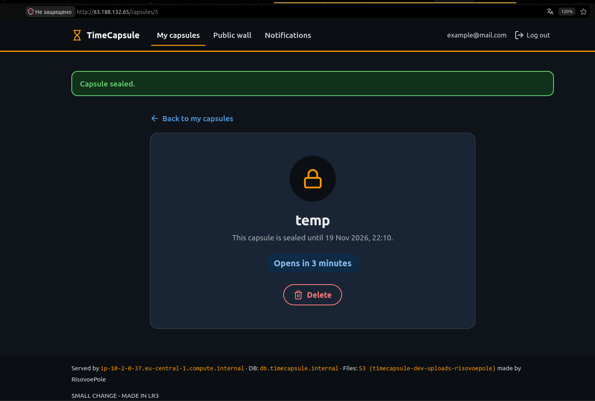

Новая капсула в интерфейсе приложения.

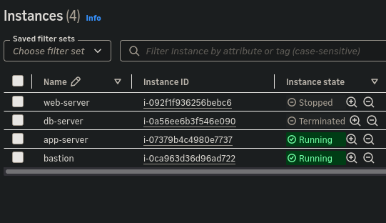

Список серверов: `db-server` остановлен и удалён.

## Задание 11. Обслуживание

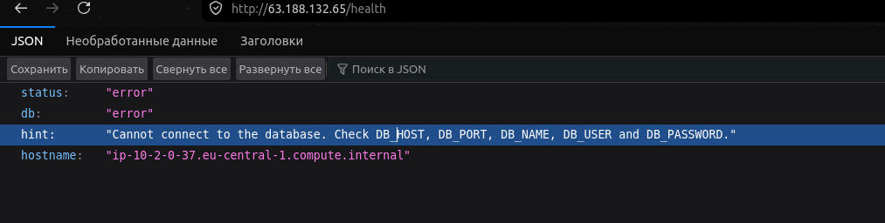

`/health` во время перезагрузки базы.

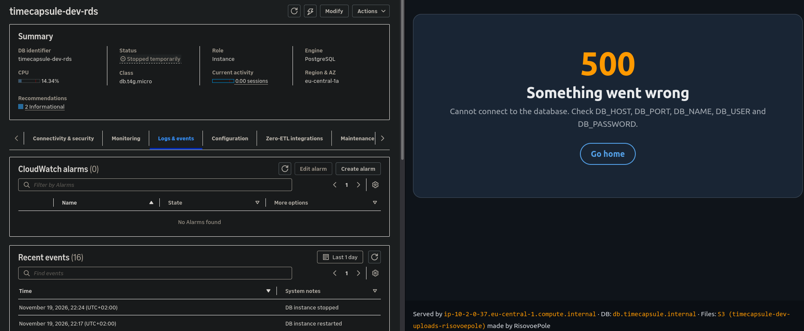

База остановлена, приложение не работает.

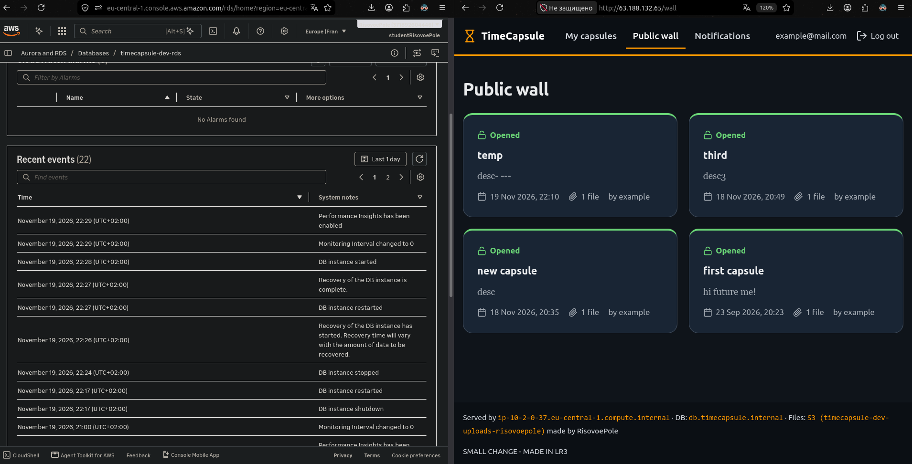

База запущена, приложение работает.


**Q:** Что показывал /health во время перезагрузки? Изменился ли endpoint после остановки и запуска? Какую ошибку получает расписание, если база уже остановлена?

**A:** Пока база перезагружалась и была недоступна, `/health` сообщал об ошибке подключения к базе; после запуска базы приложение заработало без изменений на сервере. Endpoint после остановки и запуска остался прежним, поэтому CNAME менять не нужно. Если база уже остановлена, вызов `StopDBInstance` завершается ошибкой состояния (`InvalidDBInstanceState`), потому что экземпляр не в состоянии `Available`; ошибка видна в журнале расписания.

# Архитектура

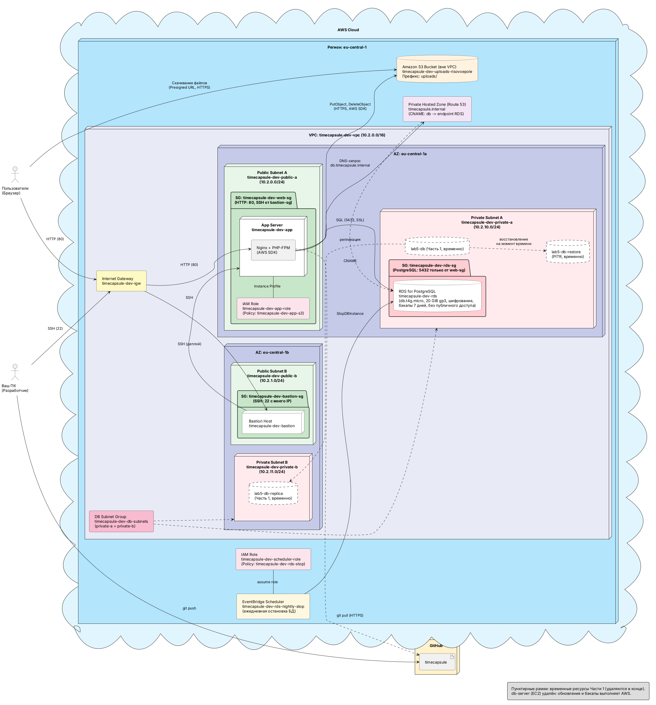

Схема архитектуры: RDS в приватной подсети, группа подсетей, CNAME в приватной зоне Route 53, расписание остановки.

Решение о размещении базы данных: [ADR-0004](docs/adr/0004-database-hosting.md).
